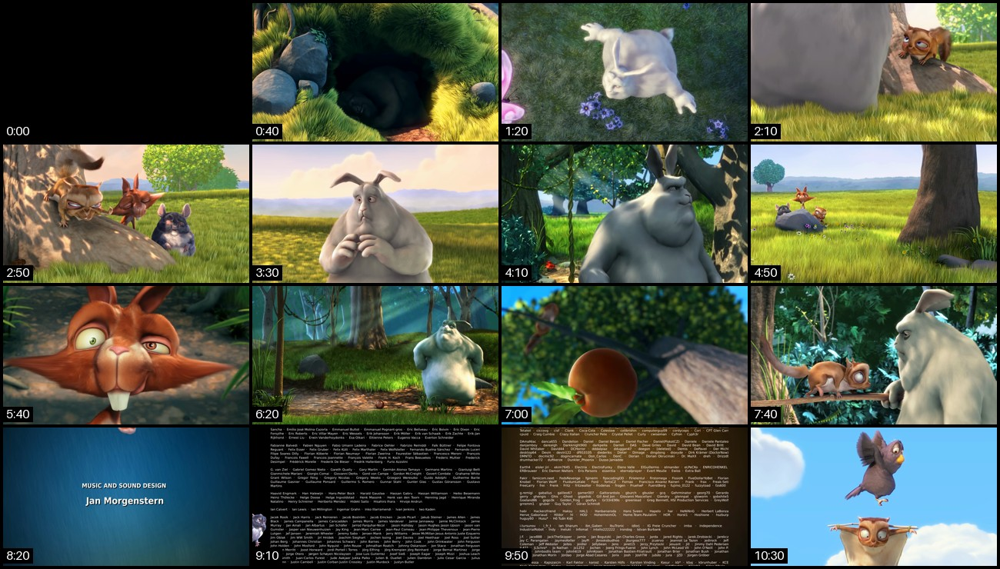

<div align="center">

# yt-img

**One video in, one image out.**
Turn a YouTube link or any local video into contact sheets of its distinct scenes, ready to hand to an AI, a chat or a ticket.

[](https://github.com/seesee010/yt-img/actions/workflows/ci.yml)


[](LICENSE)



<sub>`yt-img https://youtu.be/aqz-KE-bpKQ --single -w 320` — 10:34 of video, 64 samples, 62 distinct, squeezed into one sheet of 16.</sub>

</div>

## Quick start

Every distinct frame, in order, on sheets of 16:

```console
$ yt-img https://youtu.be/aqz-KE-bpKQ
downloading https://youtu.be/aqz-KE-bpKQ
sampling one frame every 10 s
64 sampled, 62 distinct, 62 on 4 sheets
aqz-KE-bpKQ-1.png
aqz-KE-bpKQ-2.png
aqz-KE-bpKQ-3.png
aqz-KE-bpKQ-4.png
```

Only one image allowed? Squeeze the video into a single sheet. The 16 frames are picked evenly from start to end:

```console
$ yt-img https://youtu.be/aqz-KE-bpKQ --single -q
aqz-KE-bpKQ.png
```

Local files and direct links work the same way. A short clip fits on one sheet and keeps its plain name:

```console
$ yt-img ~/Videos/talk.mkv -o talk.webp
$ yt-img https://example.com/demo.mp4 -q
demo.png
```

## Install

yt-img needs [ffmpeg](https://ffmpeg.org) on your `PATH`.

```sh
sudo pacman -S ffmpeg      # Arch
sudo apt install ffmpeg    # Debian, Ubuntu
brew install ffmpeg        # macOS

uv tool install git+https://github.com/seesee010/yt-img.git
# or: pipx install git+https://github.com/seesee010/yt-img.git
```

## How it works

```
SOURCE ──► detect ──► download ──► sample ──► distinct ──► split ──► tile ──► OUT
          YouTube?    yt-dlp      ffmpeg,     differs     16 per    grid +    one or
          URL? file?  ≤720p,      every 10 s  ≥ 5 % from  sheet     timestamps more
                      no audio                last kept   (--single:          sheets
                                                          16 evenly)
```

1. **Detect** – YouTube links (`youtube.com`, `youtu.be`, shorts, embed, live, music, with or without `https://`) go to yt-dlp. Other `http(s)` links and local files go straight to ffmpeg.
2. **Download** – only the video stream, capped at 720p. Playlists and live streams are refused before anything is downloaded.
3. **Sample** – ffmpeg keeps the first frame and then every frame at least `--interval` seconds after the previous one, with its real timestamp. Anything ffmpeg can decode works: mp4, mkv, webm, mov, avi, flv, ts, gif, m4v, ogv and more.
4. **Distinct** – a frame is kept only if it differs from the **last kept** frame by at least `--threshold`. The difference is the mean absolute RGB difference on a 64×36 thumbnail. Noise is ignored, and slow pans add up.
5. **Split** – the surviving frames are split in order into sheets of `--count`, so nothing is lost. With `--single`, `--count` frames are picked evenly over the whole video instead, always including the first and the last.
6. **Tile** – a grid with `--columns` per row and timestamps in the corner, saved as png, jpg or webp depending on the extension. Several sheets are numbered `name-1.png`, `name-2.png`, … (zero-padded from 10 on). A single sheet keeps the plain name.

## Options

| Option | Default | Meaning |
| --- | --- | --- |
| `SOURCE` | | YouTube URL, direct video URL or local video file |
| `-o`, `--output` | `<video name>.png` | Output image: `.png`, `.jpg`, `.jpeg` or `.webp`, numbered when there are several sheets |
| `-i`, `--interval` | `10` | Seconds between sampled frames (≥ 0.1) |
| `-t`, `--threshold` | `0.05` | Minimum difference to the last kept frame, 0–1. Use `0` to keep every sample |
| `-n`, `--count` | `16` | Maximum number of frames per sheet |
| `-s`, `--single` | | Squeeze everything into one sheet of `--count` frames, picked evenly over the video |
| `-c`, `--columns` | `4` | Frames per row |
| `-w`, `--width` | `480` | Width of each frame in pixels (≥ 16) |
| `--no-labels` | | Do not print timestamps on the frames |
| `-q`, `--quiet` | | Only print the output path |
| `--version` | | Print the version |

**Output contract:** stdout carries only the paths of the written images, one per line, so `yt-img … | xargs …` works. Progress goes to stderr.
**Exit codes:** `0` success · `1` error, as one `yt-img: error: …` line · `2` bad arguments · `130` interrupted.

## Development

```sh
git clone https://github.com/seesee010/yt-img.git && cd yt-img
uv sync
uv run pytest                  # 100 % line and branch coverage is enforced
uv run pytest --run-network    # also download a real YouTube video
uv run ruff check && uv run ruff format --check && uv run mypy
```

CI runs lint, format, strict mypy and the full suite on Python 3.11 to 3.14 for every pull request. The tests build real videos with ffmpeg and check the colour of every cell on the sheet.

## Contributors

| | Contributor | Role |
| --- | --- | --- |
|  | [@seesee010](https://github.com/seesee010) | Maintainer: idea, requirements, review |
|  | [Claude](https://claude.com/claude-code) (Opus 5.5, via Claude Code) | Design, implementation, tests, CI and docs |

Every commit carries a `Co-Authored-By: Claude` trailer. GitHub's contributor list only counts commit authors with a GitHub account, so Claude shows up here instead.

## License

[GPL-2.0-only](LICENSE).
The example image shows frames of [Big Buck Bunny](https://peach.blender.org/), © 2008 Blender Foundation, [CC BY 3.0](https://creativecommons.org/licenses/by/3.0/).
